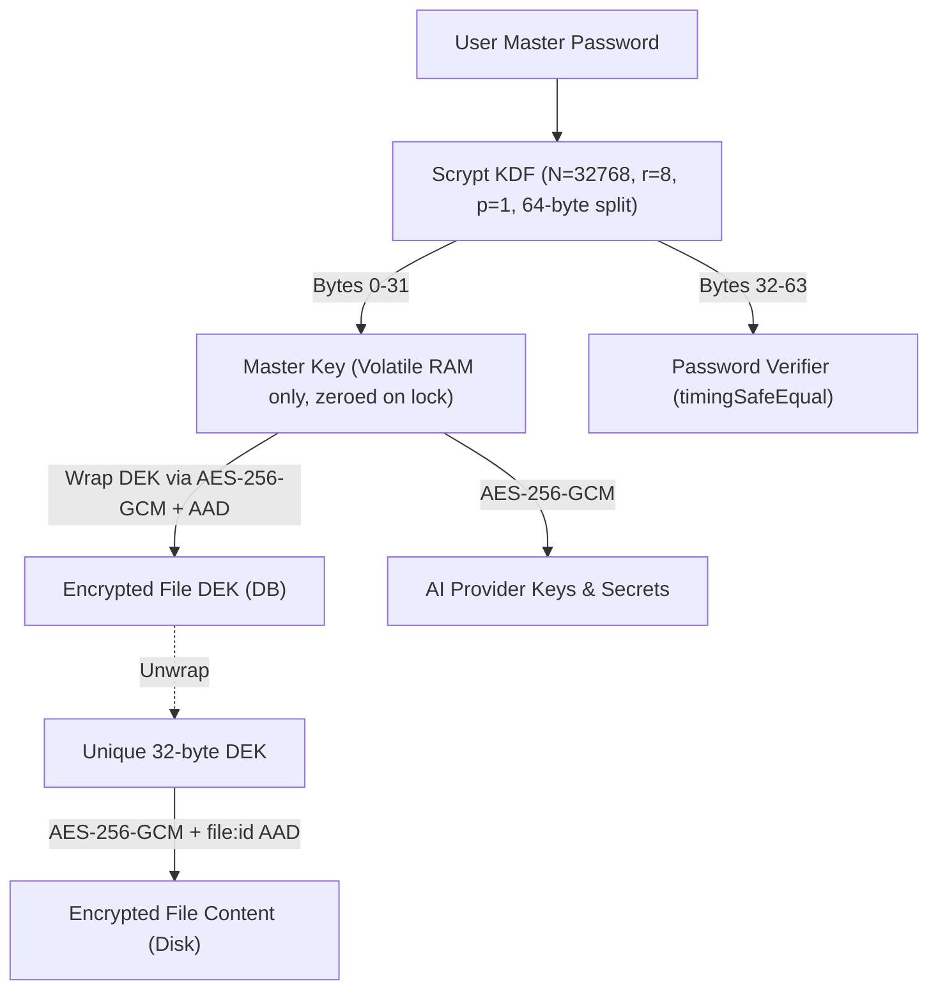

<div align="center">

```
   ____  __                                      __ _____ 
  / __ \/ /_  ______  ______  ______  _____     / //_/   |
 / /_/ / __ \/ ___/ / / / / / / __ \/ ___/____ / ,<  / /| |
/ ____/ / / / /  / /_/ / /_/ / /_/ (__  )/___// /| |/ ___ |
/_/   /_/ /_/_/   \__, /\__,_/\____/____/    /_/ |_/_/  |_|
                 /____/                    v0.1.0
```

# Phryvos K9
### 🔒 Local-First, Envelope-Encrypted AI Vault & Personal Life OS

[](https://github.com/Krishna-chthonic/Phryvos-k9/actions/workflows/ci.yml)
[](https://nextjs.org/)
[](https://react.dev/)
[](https://www.typescriptlang.org/)
[](https://sqlite.org/)
[](https://en.wikipedia.org/wiki/Galois/Counter_Mode)
[](https://termux.dev)
[](LICENSE)

<p align="center">
  <b>Phryvos K9</b> is an open-source, private-by-design personal intelligence system and life operating system.
  <br />
  Combines conversational AI, graph-linked vault files, automated workflows, and academic tracking into a single zero-trust local runtime.
  <br /><br />
  <b>Zero Cloud Telemetry · Zero Developer Relays · 100% Local Device Sovereignty</b>
</p>

[Quick Start](#-quick-start) • [Key Features](#-key-features) • [Security Model](#-security--cryptography-architecture) • [CLI Manual](#-cli-reference-phryvos-k9) • [Android / Termux](#-android--termux-native-support)

---

</div>

## 📑 Table of Contents

- [Overview & Philosophy](#-overview--philosophy)
- [✨ Key Features](#-key-features)
- [🔐 Security & Cryptography Architecture](#-security--cryptography-architecture)
- [⚡ Quick Start](#-quick-start)
  - [1. One-Line Automated Installer](#1-one-line-automated-installer-recommended)
  - [2. Manual Clone & Build](#2-manual-clone--build)
- [💻 CLI Reference (`phryvos-k9`)](#-cli-reference-phryvos-k9)
- [🤖 AI Engine & Provider Boundaries](#-ai-engine--provider-boundaries)
- [📱 Android & Termux Native Support](#-android--termux-native-support)
- [🧪 Testing & Verification](#-testing--verification)
- [🤝 Contributing & License](#-contributing--license)

---

## 💡 Overview & Philosophy

Modern AI tools demand your notes, documents, schedule, and habits—then send them to remote corporate clouds. **Phryvos K9** inverts this model:

1. **Local-First Architecture:** Your entire database (`data/vault.db`), encrypted files, project boards, and chat histories live locally on your machine.
2. **Envelope Cryptography:** Files are encrypted with individual data keys (DEKs) wrapped by a memory-only master key. Master keys never touch persistent storage.
3. **Pluggable & Hybrid AI:** Use local offline models (Ollama, LocalAI) for zero-egress environments, or connect your own API keys directly to OpenAI, Anthropic, OpenRouter, or DeepSeek with zero intermediate proxy servers.
4. **Plausible Deniability:** Salted duress PIN routing unlocks an isolated decoy Ghost Vault with identical schema and latency, safeguarding you under physical coercion.

---

## ✨ Key Features

| Capability | Highlights |
| :--- | :--- |
| **🤖 Conversational AI & Agent Loop** | Multi-session chat, streaming tokens, `@file` vault context injections, vision support, sandboxed HTML artifact previews, and cryptographic TOCTOU-resistant approval gates for destructive tools. |
| **🔌 Universal MCP Host Kernel** | Dynamic mounting of external Model Context Protocol (MCP) servers, live tool discovery, and local agent orchestration. |
| **🕸️ Knowledge Graph & [[wiki-links]]** | Bidirectional link parsing, interactive graph visualization, backlink indexing, orphan detection, and ghost link tracking across markdown documents. |
| **🧠 Spaced Repetition (FSRS-4.5)** | Modern Free Spaced Repetition Scheduler computing memory stability and difficulty decay for flashcard retention. |
| **📊 Project Tracking & DAG Critical Path** | Interactive Kanban boards, Gantt charts, topological sorting, dependency blocker graphs, and schedule diffing for project deadlines. |
| **📁 Encrypted File Manager** | Per-file AES-256-GCM + AAD envelope encryption, full-text search (SQLite FTS5), integrated Monaco editor, daily + version history rollbacks, and binary previews. |
| **🎯 Academic & Life OS** | Goal tracking with auto-computed milestone progress, exam revision planners with time logs & topic mastery sliders, and a standalone local calendar. |
| **🛡️ Duress Defense & Ghost Vault** | Salted duress PIN unlocking an isolated decoy NCERT database with identical API response shapes and auto-lock timeouts. |
| **📦 Disaster Recovery & Atomic Restore** | Automated full bundle snapshots (DB + blobs + manifest), SHA-256 integrity verification, path confinement, and atomic rollback on failed restores. |

---

## 🔐 Security & Cryptography Architecture



- **Volatile Master Key:** Held strictly in Node runtime memory (`lib/session/store.ts`). Master keys are cleared via cryptographic random wipes on vault lock or session expiration.
- **AAD Cryptographic Binding:** File envelopes bind file IDs via Additional Authenticated Data (`file:${id}`), preventing ciphertext substitution attacks between database records.
- **Hermetic Code Execution:** The built-in JavaScript code runner executes in an isolated sandbox with prototype poisoning mitigations, execution timeouts, and AST validation.
- **SQL Defense-in-Depth:** Agent database queries are gated through dedicated read-only handles with `query_only = ON`, `SELECT`/`WITH` restrictions, and forced `LIMIT` clauses.
- **Path Confinement:** Backup restore and filesystem operations enforce strict canonical directory boundaries (`isContainedIn`), rejecting directory traversal attempts (`../`) and null bytes.

---

## ⚡ Quick Start

### 1. One-Line Automated Installer (Recommended)

Compatible with **Linux**, **macOS**, and **Android Termux**:

```bash
curl -fsSL https://raw.githubusercontent.com/Krishna-chthonic/Phryvos-k9/main/install.sh | bash
```

### 2. Manual Clone & Build

Ensure you have **Node.js (v20+)** and **npm** installed:

```bash
# 1. Clone the repository
git clone https://github.com/Krishna-chthonic/Phryvos-k9.git phryvos
cd phryvos

# 2. Install dependencies & build production bundles
npm install
npm run build

# 3. Launch background daemon via CLI
./bin/phryvos.mjs start
```

Open your browser to **[http://localhost:3000](http://localhost:3000)** and configure your master vault password on first launch!

---

## 💻 CLI Reference (`phryvos-k9`)

Phryvos includes a production daemon management CLI (`phryvos-k9` or `phryvos`):

```bash
phryvos-k9 <command> [options]
```

| Command | Options | Description |
| :--- | :--- | :--- |
| `start` | `--port <num>`, `-f`, `--dev` | Launch Phryvos daemon in background (or foreground `-f`) |
| `stop` | — | Gracefully terminate the running instance and its process tree |
| `restart` | `--port <num>` | Gracefully stop and relaunch the background daemon |
| `status` | — | Inspect runtime status, active PID, and configured port |
| `logs` | `-n <lines>` | View live server logs (defaults to last 50 lines) |
| `update` | — | Safe Git updater (verifies clean tree, pulls `--ff-only`, rebuilds) |
| `version` | `-v`, `--version` | Display current installed release version |
| `help` | `-h`, `--help` | Show command usage and options manual |

---

## 🤖 AI Engine & Provider Boundaries

Phryvos gives you complete freedom over your choice of AI intelligence:

```
┌────────────────────────────────────────────────────────┐
│                      PHRYVOS K9                        │
│                                                        │
│  [Local Workflows]  ──►  Ollama / LocalAI (Offline)     │
│  [Cloud Providers]  ──►  Direct TLS (No Middleman)     │
└───────────────┬────────────────────────┬───────────────┘
                │                        │
         ┌──────▼──────┐          ┌──────▼──────┐
         │ Localhost   │          │ Provider API│
         │ (127.0.0.1) │          │ (HTTPS direct)
         └─────────────┘          └─────────────┘
```

- **Local Inference (Ollama / LocalAI):** Prompts, `@file` context, and embeddings never leave your machine.
- **Direct Remote Inference (OpenAI / Anthropic / OpenRouter / DeepSeek / Groq):** Direct client-to-provider HTTPS communication. Your API keys are encrypted at rest with your master key.

---

## 📱 Android & Termux Native Support

Phryvos runs seamlessly on Android devices inside Termux / PRoot:

```bash
# Set glibc PATH in proot/termux:
export PATH=/usr/bin:/usr/sbin:/sbin:/bin:/usr/local/bin:$PATH

# Start daemon
phryvos-k9 start --port 3000
```

Access Phryvos from your Android browser or over your local network via Wi-Fi.

---

## 🧪 Testing & Verification

Phryvos maintains an extensive test suite verifying cryptographic invariants, agent guardrails, and data ownership:

```bash
# Typecheck
npm run typecheck

# Execute unit and security test suites (94 tests across 32 suites)
npm test

# Build production bundle
npm run build
```

---

## 🤝 Contributing & License

Contributions, feature suggestions, and bug reports are warmly welcome!

1. Fork the repository
2. Create your feature branch (`git checkout -b feature/amazing-feature`)
3. Verify test suites pass (`npm test && npm run typecheck`)
4. Commit your changes (`git commit -m 'feat: add amazing feature'`)
5. Push to the branch (`git push origin feature/amazing-feature`)
6. Open a Pull Request

Distributed under the **MIT License**. See [`LICENSE`](LICENSE) for full details.
