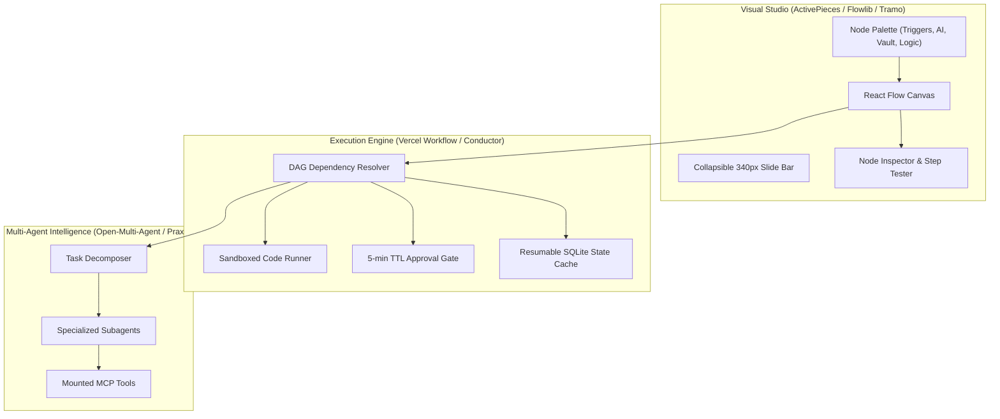

# Phryvos-K9: Workflow & Flow Architecture Reference Repositories

This document serves as the permanent registry and architectural reference for the workflow, DAG engine, visual flow builder, and multi-agent pipeline repositories saved for Phryvos-K9.

---

## 1. Primary Flow & Visual Builder Repositories

### 1. `robase/flowlib`
- **URL:** [https://github.com/robase/flowlib](https://github.com/robase/flowlib)
- **Core Focus:** React Flow component library, custom nodes, interactive edge routing, and node property inspection.
- **Key Concepts to Adapt:**
  - Standardized node container structure with typed handles (`source`, `target`).
  - Clean edge connection validation (preventing cycles, matching output/input types).
  - Floating mini-controls and minimap styling.

### 2. `synergycodes/workflowbuilder`
- **URL:** [https://github.com/synergycodes/workflowbuilder](https://github.com/synergycodes/workflowbuilder)
- **Core Focus:** Open-source, production-ready diagram and workflow building blocks with customizable drag-and-drop canvas.
- **Key Concepts to Adapt:**
  - Slide-in side drawer for node configuration and validation.
  - Step-by-step visual execution flow highlighting.
  - Drag-and-drop node creation directly from the palette onto the canvas.

### 3. `vercel/workflow`
- **URL:** [https://github.com/vercel/workflow](https://github.com/vercel/workflow)
- **Core Focus:** Durable execution engine, step functions, state persistence, automatic retries, and sleep/delay management.
- **Key Concepts to Adapt:**
  - Resumable workflow execution: every step output is cached in SQLite so failed or paused workflows can resume without re-running completed steps.
  - Asynchronous human-in-the-loop approval gates (pauses execution until approved or TTL expires).

### 4. `activepieces/activepieces`
- **URL:** [https://github.com/activepieces/activepieces](https://github.com/activepieces/activepieces)
- **Core Focus:** Open-source automation engine with 200+ piece integrations (HTTP, Webhooks, Telegram, Files, Schedules, Code).
- **Key Concepts to Adapt:**
  - Piece/Action schema format (inputs, outputs, test payload, runner function).
  - Webhook listener endpoints and cron dispatcher structure.
  - Data mapping syntax (`{{ step_1.output.id }}`).

### 5. `oomol-lab/open-flow`
- **URL:** [https://github.com/oomol-lab/open-flow](https://github.com/oomol-lab/open-flow)
- **Core Focus:** Open visual workflow platform designed for AI pipelines, LLM prompt chaining, and local data transformations.
- **Key Concepts to Adapt:**
  - AI prompt nodes with dynamic context injection from preceding nodes.
  - Visual data inspector showing before/after diffs of step outputs.

### 6. `jhd3197/Tramo`
- **URL:** [https://github.com/jhd3197/Tramo](https://github.com/jhd3197/Tramo)
- **Core Focus:** Lightweight React Flow visual automation canvas with modular node ports, dynamic edge labeling, and run state management.
- **Key Concepts to Adapt:**
  - Compact node card layout with minimal borders and clear status indicators.
  - Lightweight execution controller.

---

## 2. Orchestration, Multi-Agent & Execution Engines

### 7. `conductor-oss/conductor`
- **URL:** [https://github.com/conductor-oss/conductor](https://github.com/conductor-oss/conductor) (Netflix Conductor OSS)
- **Core Focus:** Battle-tested distributed orchestration platform for microservices and complex stateful workflows.
- **Key Concepts to Adapt:**
  - Directed Acyclic Graph (DAG) task scheduling and dependency management.
  - Fork/Join parallel execution logic.
  - Deterministic failure handling and fallback paths.

### 8. `open-multi-agent/open-multi-agent`
- **URL:** [https://github.com/open-multi-agent/open-multi-agent](https://github.com/open-multi-agent/open-multi-agent)
- **Core Focus:** Multi-agent collaboration framework, agent message passing, tool delegation, and collective problem solving.
- **Key Concepts to Adapt:**
  - Agent delegation node: routing subtasks to specialized subagents (Research, Code, Summarizer).
  - Inter-agent memory sharing and consensus checking.

### 9. `praxa-labs/praxa`
- **URL:** [https://github.com/praxa-labs/praxa](https://github.com/praxa-labs/praxa)
- **Core Focus:** Autonomous agent workflows, secure execution environments, and tool gating.
- **Key Concepts to Adapt:**
  - Sandboxed execution for JavaScript/Python script nodes.
  - Cryptographic tool authorization before destructive mutations.

### 10. `shogo-labs/shogo-ai`
- **URL:** [https://github.com/shogo-labs/shogo-ai](https://github.com/shogo-labs/shogo-ai)
- **Core Focus:** Visual AI pipeline orchestration with multi-modal inputs, model switching, and real-time streaming output.
- **Key Concepts to Adapt:**
  - Model selector integration per AI node (local vs cloud).
  - Real-time streaming token animation on node cards during execution.

---

## 3. Integration Blueprint for Phryvos-K9

